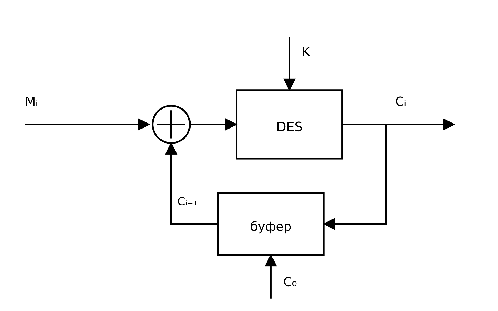
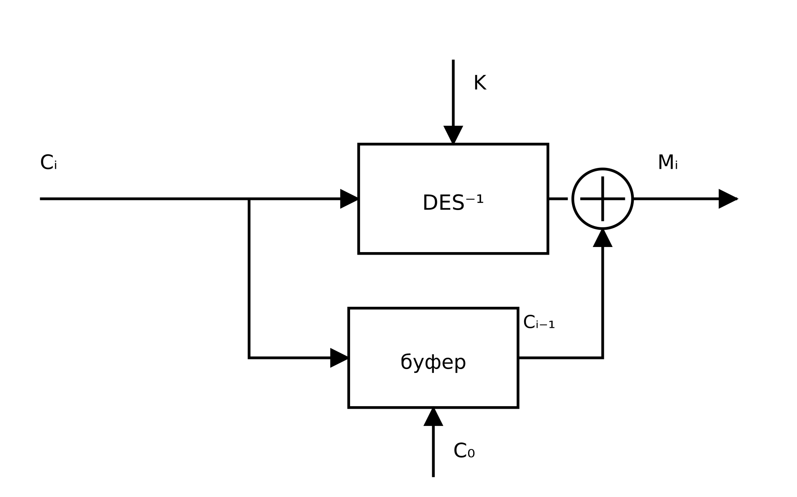
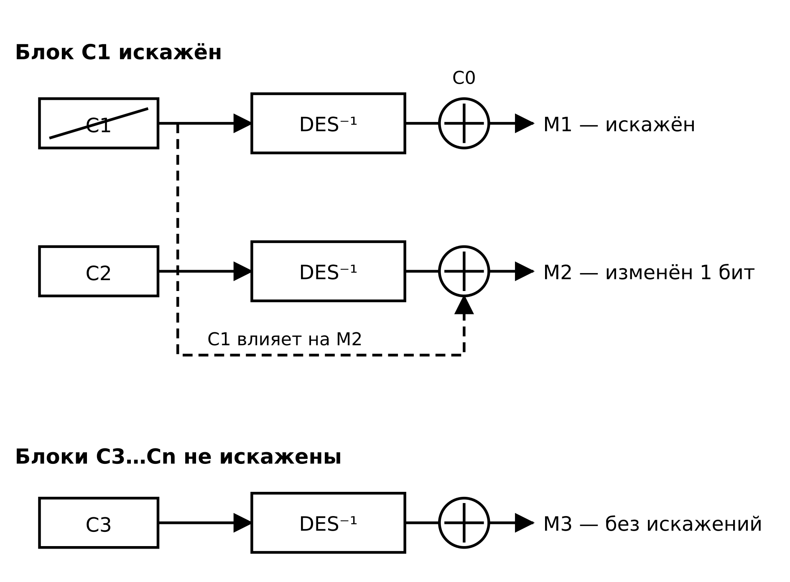

<!-- TITLEPAGE -->

## 1. Цель работы:

Целью работы является знакомство с особенностями работы алгоритма DES в режиме CBC.

## 2. Текст программы.

Обобщенная схема шифрования DES в режиме CBC приведена на рисунке 1, схема дешифрования — на рисунке 2.





Блок-схемы алгоритмов выполнены в соответствии с ГОСТ 19.701‑90.

Программа реализована на языке Go и не использует библиотечных реализаций блочного шифрования: все преобразования алгоритма DES выполнены непосредственно в коде. Базовая реализация DES — таблицы IP, IP⁻¹, E, S1–S8, P, PC‑1, PC‑2, LS, функции GenerateKeys, Feistel, EncryptBlock и DecryptBlock — перенесена из лабораторной работы №4. Программа откомпилирована и проверена; результаты ее выполнения приведены в пп. 3–5.

В состав программы входят следующие функциональные элементы.

**Режим CBC.** Функция EncryptCBC обрабатывает входные данные порциями по 8 байт. Для каждого блока вычисляется значение Ci = DES(K, Mi ⊕ C(i−1)), после чего полученный блок шифртекста становится предыдущим для следующего блока. Функция DecryptCBC выполняет обратное преобразование: Mi = C(i−1) ⊕ DES⁻¹(K, Ci). Начальный вектор C0 подается в буфер перед обработкой первого блока.

**Генератор начального вектора.** 64-битовый начальный вектор C0 формируется датчиком ПСЧ, разработанным в лабораторной работе №3. Использован линейный конгруэнтный генератор T(i+1) = (5·T(i) + 51) mod 256 с начальным состоянием T(0) = 0x2A. Для получения 64-битного вектора берутся восемь последовательных значений T(0)…T(7): 2A 05 4C AF 9E 49 A0 53. Соответствующий начальный вектор C0 = 0x2A054CAF9E49A053.

**Дополнение по стандарту PKCS#7.** Функция PKCS7Pad дополняет входные данные до кратности размеру блока; каждый байт дополнения равен количеству добавленных байтов. Функция PKCS7Unpad снимает дополнение и проверяет его корректность.

**Управляющая функция main** последовательно выполняет три эксперимента: базовое шифрование и дешифрование текста в режиме CBC; искажение одного бита шифрограммы и дешифрование искаженных данных; шифрование текста с двумя одинаковыми 64-битными блоками в режимах ECB и CBC.

Ниже приведен полный листинг программы (файл lab5/main.go).

https://github.com/kukirmash/labs/tree/main/7sem/ZI/lab5

```go
package main

import (
	"bytes"
	"encoding/binary"
	"errors"
	"fmt"
	"math/bits"
)

// ------------------------------------------------------------------------
// IP — таблица начальной перестановки (Initial Permutation) с нумерацией битов от 1 до 64
var IP = [64]int{
	58, 50, 42, 34, 26, 18, 10, 2,
	60, 52, 44, 36, 28, 20, 12, 4,
	62, 54, 46, 38, 30, 22, 14, 6,
	64, 56, 48, 40, 32, 24, 16, 8,
	57, 49, 41, 33, 25, 17, 9, 1,
	59, 51, 43, 35, 27, 19, 11, 3,
	61, 53, 45, 37, 29, 21, 13, 5,
	63, 55, 47, 39, 31, 23, 15, 7,
}

// IPInv — таблица 2 обратной конечной перестановки (IP-1)
var IPInv = [64]int{
	40, 8, 48, 16, 56, 24, 64, 32,
	39, 7, 47, 15, 55, 23, 63, 31,
	38, 6, 46, 14, 54, 22, 62, 30,
	37, 5, 45, 13, 53, 21, 61, 29,
	36, 4, 44, 12, 52, 20, 60, 28,
	35, 3, 43, 11, 51, 19, 59, 27,
	34, 2, 42, 10, 50, 18, 58, 26,
	33, 1, 41, 9, 49, 17, 57, 25,
}

// ------------------------------------------------------------------------
// E — таблица 3 расширения (32 бита -> 48 бит)
var E = [48]int{
	32, 1, 2, 3, 4, 5,
	4, 5, 6, 7, 8, 9,
	8, 9, 10, 11, 12, 13,
	12, 13, 14, 15, 16, 17,
	16, 17, 18, 19, 20, 21,
	20, 21, 22, 23, 24, 25,
	24, 25, 26, 27, 28, 29,
	28, 29, 30, 31, 32, 1,
}

// ------------------------------------------------------------------------
// SBox — таблицы 4 нелинейных подстановок (8 блоков по 4 строки и 16 столбцов)
var SBox = [8][4][16]byte{
	{ // S1
		{14, 4, 13, 1, 2, 15, 11, 8, 3, 10, 6, 12, 5, 9, 0, 7},
		{0, 15, 7, 4, 14, 2, 13, 1, 10, 6, 12, 11, 9, 5, 3, 8},
		{4, 1, 14, 8, 13, 6, 2, 11, 15, 12, 9, 7, 3, 10, 5, 0},
		{15, 12, 8, 2, 4, 9, 1, 7, 5, 11, 3, 14, 10, 0, 6, 13},
	},
	{ // S2
		{15, 1, 8, 14, 6, 11, 3, 4, 9, 7, 2, 13, 12, 0, 5, 10},
		{3, 13, 4, 7, 15, 2, 8, 14, 12, 0, 1, 10, 6, 9, 11, 5},
		{0, 14, 7, 11, 10, 4, 13, 1, 5, 8, 12, 6, 9, 3, 2, 15},
		{13, 8, 10, 1, 3, 15, 4, 2, 11, 6, 7, 12, 0, 5, 14, 9},
	},
	{ // S3
		{10, 0, 9, 14, 6, 3, 15, 5, 1, 13, 12, 7, 11, 4, 2, 8},
		{13, 7, 0, 9, 3, 4, 6, 10, 2, 8, 5, 14, 12, 11, 15, 1},
		{13, 6, 4, 9, 8, 15, 3, 0, 11, 1, 2, 12, 5, 10, 14, 7},
		{1, 10, 13, 0, 6, 9, 8, 7, 4, 15, 14, 3, 11, 5, 2, 12},
	},
	{ // S4
		{7, 13, 14, 3, 0, 6, 9, 10, 1, 2, 8, 5, 11, 12, 4, 15},
		{13, 8, 11, 5, 6, 15, 0, 3, 4, 7, 2, 12, 1, 10, 14, 9},
		{10, 6, 9, 0, 12, 11, 7, 13, 15, 1, 3, 14, 5, 2, 8, 4},
		{3, 15, 0, 6, 10, 1, 13, 8, 9, 4, 5, 11, 12, 7, 2, 14},
	},
	{ // S5
		{2, 12, 4, 1, 7, 10, 11, 6, 8, 5, 3, 15, 13, 0, 14, 9},
		{14, 11, 2, 12, 4, 7, 13, 1, 5, 0, 15, 10, 3, 9, 8, 6},
		{4, 2, 1, 11, 10, 13, 7, 8, 15, 9, 12, 5, 6, 3, 0, 14},
		{11, 8, 12, 7, 1, 14, 2, 13, 6, 15, 0, 9, 10, 4, 5, 3},
	},
	{ // S6
		{12, 1, 10, 15, 9, 2, 6, 8, 0, 13, 3, 4, 14, 7, 5, 11},
		{10, 15, 4, 2, 7, 12, 9, 5, 6, 1, 13, 14, 0, 11, 3, 8},
		{9, 14, 15, 5, 2, 8, 12, 3, 7, 0, 4, 10, 1, 13, 11, 6},
		{4, 3, 2, 12, 9, 5, 15, 10, 11, 14, 1, 7, 6, 0, 8, 13},
	},
	{ // S7
		{4, 11, 2, 14, 15, 0, 8, 13, 3, 12, 9, 7, 5, 10, 6, 1},
		{13, 0, 11, 7, 4, 9, 1, 10, 14, 3, 5, 12, 2, 15, 8, 6},
		{1, 4, 11, 13, 12, 3, 7, 14, 10, 15, 6, 8, 0, 5, 9, 2},
		{6, 11, 13, 8, 1, 4, 10, 7, 9, 5, 0, 15, 14, 2, 3, 12},
	},
	{ // S8
		{13, 2, 8, 4, 6, 15, 11, 1, 10, 9, 3, 14, 5, 0, 12, 7},
		{1, 15, 13, 8, 10, 3, 7, 4, 12, 5, 6, 11, 0, 14, 9, 2},
		{7, 11, 4, 1, 9, 12, 14, 2, 0, 6, 10, 13, 15, 13, 5, 8},
		{2, 1, 14, 7, 4, 10, 8, 13, 5, 12, 9, 0, 3, 5, 5, 11},
	},
}

// ------------------------------------------------------------------------
// P — таблица 5 перестановки внутри функции Фейстеля
var P = [32]int{
	16, 7, 20, 21, 29, 12, 28, 17, 1, 15, 23, 26, 5, 18, 31, 10,
	2, 8, 24, 14, 32, 27, 3, 9, 19, 13, 30, 6, 22, 11, 4, 25,
}

// ------------------------------------------------------------------------
// PC1 — таблица 6 перестановки-выбора PC-1 (56 элементов, нумерация битов от 1 до 64)
var PC1 = [56]int{
	57, 49, 41, 33, 25, 17, 9, 1, 58, 50, 42, 34, 26, 18,
	10, 2, 59, 51, 43, 35, 27, 19, 11, 3, 60, 52, 44, 36,
	63, 55, 47, 39, 31, 23, 15, 7, 62, 54, 46, 38, 30, 22,
	14, 6, 61, 53, 45, 37, 29, 21, 13, 5, 28, 20, 12, 4,
}

// ------------------------------------------------------------------------
// LS — таблица 7 циклических сдвигов для 16 раундов
var LS = [16]int{
	1, 1, 2, 2, 2, 2, 2, 2, 1, 2, 2, 2, 2, 2, 2, 1,
}

// ------------------------------------------------------------------------
// PC2 — таблица 8 перестановки-выбора PC-2 (48 элементов)
var PC2 = [48]int{
	14, 17, 11, 24, 1, 5, 3, 28, 15, 6, 21, 10,
	23, 19, 12, 4, 26, 8, 16, 7, 27, 20, 13, 2,
	41, 52, 31, 37, 47, 55, 30, 40, 51, 45, 33, 48,
	44, 49, 39, 56, 34, 53, 46, 42, 50, 36, 29, 32,
}

// ------------------------------------------------------------------------
// PKCS7Pad дополняет срез байт до кратности blockSize (для DES это 8 байт / 64 бита)
func PKCS7Pad(data []byte, blockSize int) []byte {
	//
	padding := blockSize - (len(data) % blockSize)

	padBytes := bytes.Repeat([]byte{byte(padding)}, padding)
	return append(data, padBytes...)
}

// ------------------------------------------------------------------------
// PKCS7Unpad удаляет дополнение PKCS#7 после дешифрования
func PKCS7Unpad(data []byte) ([]byte, error) {
	length := len(data)
	if length == 0 || length%8 != 0 {
		return nil, errors.New("некорректная длина данных для снятия дополнения")
	}

	padLen := int(data[length-1])
	if padLen == 0 || padLen > 8 {
		return nil, errors.New("некорректное значение байта дополнения")
	}

	for i := length - padLen; i < length; i++ {
		if data[i] != byte(padLen) {
			return nil, errors.New("нарушена целостность байтов дополнения")
		}
	}

	return data[:length-padLen], nil
}

// ------------------------------------------------------------------------
// 64 -> 64
func PermuteIP(val uint64) uint64 {
	var res uint64

	for i := 0; i < 64; i++ {
		pos := IP[i]

		bit := (val >> (64 - pos)) & 1

		res |= bit << (63 - i)
	}
	return res
}

// ------------------------------------------------------------------------
func PermuteIPInv(val uint64) uint64 {
	var res uint64

	for i := 0; i < 64; i++ {
		pos := IPInv[i]
		bit := (val >> (64 - pos)) & 1
		res |= bit << (63 - i)
	}
	return res
}

// ------------------------------------------------------------------------
// 64 -> 56
func PermutePC1(key uint64) uint64 {
	var key56 uint64

	for i := 0; i < 56; i++ {
		// Номер бита в 64-битном ключе (от 1 до 64)
		pos := PC1[i]

		// Извлекаем бит из ключа (1-й бит — самый старший, сдвиг на 64 - pos)
		bit := (key >> (64 - pos)) & 1

		// Укладываем бит в 56-битное число от старшего к младшему (55 - i)
		key56 |= bit << (55 - i)
	}

	return key56
}

// ------------------------------------------------------------------------
// 56 -> 48
func PermutePC2(key uint64) uint64 {

	var key48 uint64
	for i := 0; i < 48; i++ {
		// Номер бита в 56-битном векторе (от 1 до 56)
		pos := PC2[i]

		// Извлекаем нужный бит. 1-й бит вектора cd — старший (находится на позиции 55)
		bit := (key >> (56 - pos)) & 1

		// Укладываем бит в 48-битный раундовый ключ от старшего к младшему (сдвиг 47 - i)
		key48 |= bit << (47 - i)
	}

	return key48
}

// ------------------------------------------------------------------------
// 32 -> 48
func PermuteE(val uint32) uint64 {
	var res uint64

	for i := 0; i < 48; i++ {
		pos := E[i]

		bit := (val >> (32 - pos)) & 1

		res |= uint64(bit) << (47 - i)
	}
	return res
}

// ------------------------------------------------------------------------
// 32 -> 32
func PermuteP(val uint32) uint32 {
	var res uint32

	for i := 0; i < 32; i++ {
		pos := P[i]

		bit := (val >> (32 - pos)) & 1

		res |= bit << (31 - i)
	}
	return res
}

// ------------------------------------------------------------------------
func GenerateKeys(srcKey uint64) [16]uint64 {
	var key56 uint64 = PermutePC1(srcKey)

	// L0 (в коде - левая часть) — это старшие 28 бит. Сдвигаем вправо на 28 позиций.
	var L uint32 = uint32(key56 >> 28)

	// R0 (в коде - правая часть) — это младшие 28 бит. Оставляем только их с помощью маски.
	// 0x0FFFFFFF в двоичном виде — это ровно 28 единиц.
	var R uint32 = uint32(key56 & 0x0FFFFFFF)

	var keys [16]uint64

	for i := 0; i < 16; i++ {

		shift := LS[i]

		// Выполняем циклический сдвиг влево на shift позиций для каждой 28-битной половины.
		// Конструкция (val >> (28 - shift)) переносит старшие выпадающие биты в младшие разряды.
		L = ((L << shift) | (L >> (28 - shift))) & 0x0FFFFFFF
		R = ((R << shift) | (R >> (28 - shift))) & 0x0FFFFFFF

		// Склеиваем сдвинутые половины обратно в единый 56-битный вектор.
		// Левая половина сдвигается на 28 позиций влево, правая добавляется через "ИЛИ".
		cd := (uint64(L) << 28) | uint64(R)

		// Применяем перестановку-выбор PC-2 для получения 48-битного ключа
		keys[i] = PermutePC2(cd)
	}

	return keys
}

// ------------------------------------------------------------------------
// Feistel выполняет функцию f(R, K) для одного раунда
func Feistel(r uint32, key uint64) uint32 {

	// Расширение
	var e uint64 = PermuteE(r)

	// Гаммирование
	B := e ^ key

	// Преобразование в S-блоках (48 бит -> 32 бита)
	var s uint32
	for i := 0; i < 8; i++ {

		// 6-битный вектор
		vector6 := byte((B >> (42 - i*6)) & 0x3F)

		// 1,6
		k := ((vector6 >> 4) & 0x2) | (vector6 & 0x1)
		// 2,3,4,5
		l := (vector6 >> 1) & 0xF

		// Получаем 4-битное значение из S-блока
		val4 := uint32(SBox[i][k][l])

		// Укладываем 4 бита в итоговый 32-битный вектор
		s |= val4 << (28 - i*4)
	}

	// Перестановка P
	result := PermuteP(s)

	return result
}

// ------------------------------------------------------------------------
// EncryptBlock шифрует один 64-битный блок
func EncryptBlock(block uint64, keys [16]uint64) uint64 {
	// Начальная перестановка
	block = PermuteIP(block)

	// Разделение на левую и правую 32-битные половины
	L := uint32(block >> 32)
	R := uint32(block & 0xFFFFFFFF)

	// 16 раундов сети Фейстеля
	for i := 0; i < 16; i++ {
		nextL := R
		nextR := L ^ Feistel(R, keys[i])

		L = nextL
		R = nextR
	}

	// Склейка половин в обратном порядке (R16, L16)
	reversedBlock := (uint64(R) << 32) | uint64(L)

	// Конечная обратная перестановка
	return PermuteIPInv(reversedBlock)
}

// ------------------------------------------------------------------------
// DecryptBlock расшифровывает один 64-битный блок
func DecryptBlock(block uint64, keys [16]uint64) uint64 {
	block = PermuteIP(block)

	L := uint32(block >> 32)
	R := uint32(block & 0xFFFFFFFF)

	// Те же 16 раундов, но ключи идут в обратном порядке (от 15 к 0)
	for i := 15; i >= 0; i-- {
		nextL := R
		nextR := L ^ Feistel(R, keys[i])

		L = nextL
		R = nextR
	}

	reversedBlock := (uint64(R) << 32) | uint64(L)

	return PermuteIPInv(reversedBlock)
}

// ------------------------------------------------------------------------
// EncryptECB шифрует срез байт (кратный 8) в режиме ECB
func EncryptECB(data []byte, keys [16]uint64) []byte {
	encrypted := make([]byte, len(data))
	for i := 0; i < len(data); i += 8 {
		block := binary.BigEndian.Uint64(data[i : i+8])
		encryptedBlock := EncryptBlock(block, keys)
		binary.BigEndian.PutUint64(encrypted[i:i+8], encryptedBlock)
	}
	return encrypted
}

// ------------------------------------------------------------------------
// DecryptECB расшифровывает срез байт (кратный 8) в режиме ECB
func DecryptECB(cipherData []byte, keys [16]uint64) []byte {
	decrypted := make([]byte, len(cipherData))
	for i := 0; i < len(cipherData); i += 8 {
		block := binary.BigEndian.Uint64(cipherData[i : i+8])
		decryptedBlock := DecryptBlock(block, keys)
		binary.BigEndian.PutUint64(decrypted[i:i+8], decryptedBlock)
	}
	return decrypted
}

// ------------------------------------------------------------------------
// EncryptCBC шифрует срез байт (кратный 8) в режиме CBC
func EncryptCBC(data []byte, keys [16]uint64, iv uint64) []byte {
	if len(data)%8 != 0 {
		panic("длина данных должна быть кратна 8 байтам")
	}

	encrypted := make([]byte, len(data))
	prev := iv

	for i := 0; i < len(data); i += 8 {
		block := binary.BigEndian.Uint64(data[i : i+8])
		encryptedBlock := EncryptBlock(block^prev, keys)
		binary.BigEndian.PutUint64(encrypted[i:i+8], encryptedBlock)

		// Каждый следующий блок сцепляется с предыдущим блоком шифртекста
		prev = encryptedBlock
	}

	return encrypted
}

// ------------------------------------------------------------------------
// DecryptCBC расшифровывает срез байт (кратный 8) в режиме CBC
func DecryptCBC(cipherData []byte, keys [16]uint64, iv uint64) []byte {
	if len(cipherData)%8 != 0 {
		panic("длина шифртекста должна быть кратна 8 байтам")
	}

	decrypted := make([]byte, len(cipherData))
	prev := iv

	for i := 0; i < len(cipherData); i += 8 {
		block := binary.BigEndian.Uint64(cipherData[i : i+8])
		decryptedBlock := DecryptBlock(block, keys) ^ prev
		binary.BigEndian.PutUint64(decrypted[i:i+8], decryptedBlock)

		// Для следующего блока предыдущим является текущий блок шифртекста
		prev = block
	}

	return decrypted
}

// ------------------------------------------------------------------------
// LCG — линейный конгруэнтный генератор, разработанный в лабораторной работе №3:
// T(i+1) = (5 * T(i) + 51) mod 256
type LCG struct {
	state uint8
}

// ------------------------------------------------------------------------
func NewLCG(seed uint8) *LCG {
	return &LCG{state: seed}
}

// ------------------------------------------------------------------------
// NextByte возвращает текущее значение T(i) и переходит к T(i+1)
func (g *LCG) NextByte() byte {
	value := g.state
	g.state = byte((5*int(g.state) + 51) % 256)
	return value
}

// ------------------------------------------------------------------------
// GenerateIV формирует 64-битный начальный вектор C0 из восьми значений ПСЧ
func GenerateIV(seed uint8) uint64 {
	generator := NewLCG(seed)
	var iv uint64

	for i := 0; i < 8; i++ {
		iv = (iv << 8) | uint64(generator.NextByte())
	}

	return iv
}

// ------------------------------------------------------------------------
// DiffBits возвращает количество различающихся бит в двух 64-битных блоках
func DiffBits(a uint64, b uint64) int {
	return bits.OnesCount64(a ^ b)
}

// ------------------------------------------------------------------------
func main() {
	str := "Режим CBC связывает блоки шифрограммы."

	var srcKey uint64 = 0x13_34_57_79_9B_BC_DF_F1
	keys := GenerateKeys(srcKey)

	// Начальный вектор C0 формируется генератором ПСЧ из лабораторной работы №3.
	// Начальное состояние выбрано произвольно: T0 = 0x2A.
	const ivSeed uint8 = 0x2A
	iv := GenerateIV(ivSeed)

	paddedData := PKCS7Pad([]byte(str), 8)

	// =========================================================================
	// ЭКСПЕРИМЕНТ 1: Шифрование и дешифрование в режиме CBC
	fmt.Println("=== 1. ШИФРОВАНИЕ И ДЕШИФРОВАНИЕ (CBC) ===")
	fmt.Println("Исходная строка:", str)
	fmt.Printf("Ключ K: 0x%016X\n", srcKey)
	fmt.Printf("Параметры ПСЧ: A = 5, C = 51, B = 256, T0 = 0x%02X\n", ivSeed)
	ivGenerator := NewLCG(ivSeed)
	fmt.Print("Последовательность ПСЧ T0..T7: ")
	for i := 0; i < 8; i++ {
		fmt.Printf("%02X ", ivGenerator.NextByte())
	}
	fmt.Println()
	fmt.Printf("Начальный вектор C0 (HEX): 0x%016X\n", iv)
	fmt.Printf("Длина исходного текста: %d байт; после PKCS#7: %d байт; блоков: %d\n",
		len([]byte(str)), len(paddedData), len(paddedData)/8)

	encryptedData := EncryptCBC(paddedData, keys, iv)
	fmt.Printf("Шифртекст (HEX): %X\n", encryptedData)

	decryptedData := DecryptCBC(encryptedData, keys, iv)
	unpaddedData, err := PKCS7Unpad(decryptedData)
	if err != nil {
		fmt.Println("Ошибка дешифрования/padding:", err)
		return
	}
	fmt.Println("Расшифрованная строка:", string(unpaddedData))
	fmt.Println("Совпадение с исходным текстом:", string(unpaddedData) == str)
	fmt.Println()

	// =========================================================================
	// ЭКСПЕРИМЕНТ 2: Искажение одного бита шифрограммы
	fmt.Println("=== 2. ИСКАЖЕНИЕ ОДНОГО БИТА В ШИФРОГРАММЕ ===")

	// Копируем шифртекст и инвертируем младший бит в первом байте первого блока
	corruptedCipher := make([]byte, len(encryptedData))
	copy(corruptedCipher, encryptedData)
	corruptedCipher[0] ^= 0x01

	originalC1 := binary.BigEndian.Uint64(encryptedData[:8])
	corruptedC1 := binary.BigEndian.Uint64(corruptedCipher[:8])
	fmt.Printf("Блок C1 до искажения:   %016X\n", originalC1)
	fmt.Printf("Блок C1 после искажения: %016X\n", corruptedC1)
	fmt.Printf("Искаженный шифртекст (HEX): %X\n", corruptedCipher)

	corruptedDecrypted := DecryptCBC(corruptedCipher, keys, iv)
	corruptedUnpadded, err := PKCS7Unpad(corruptedDecrypted)
	if err != nil {
		fmt.Println("Ошибка padding:", err)
		corruptedUnpadded = corruptedDecrypted
	}

	fmt.Println("Сравнение блоков открытого текста (с учетом дополнения):")
	for i := 0; i < len(decryptedData); i += 8 {
		originalBlock := binary.BigEndian.Uint64(decryptedData[i : i+8])
		corruptedBlock := binary.BigEndian.Uint64(corruptedDecrypted[i : i+8])
		fmt.Printf("  Блок %2d: %016X -> %016X (различие: %d бит)\n",
			i/8+1, originalBlock, corruptedBlock, DiffBits(originalBlock, corruptedBlock))
	}

	fmt.Printf("Исходный открытый текст (HEX):  %X\n", unpaddedData)
	fmt.Printf("Искаженный открытый текст (HEX): %X\n", corruptedUnpadded)
	fmt.Printf("Искаженный открытый текст: %q\n", string(corruptedUnpadded))
	fmt.Println()

	// =========================================================================
	// ЭКСПЕРИМЕНТ 3: Одинаковые блоки открытого текста в режимах ECB и CBC
	fmt.Println("=== 3. ОДИНАКОВЫЕ БЛОКИ ОТКРЫТОГО ТЕКСТА ===")

	sameStr := "BLOCK123BLOCK123"
	samePadded := PKCS7Pad([]byte(sameStr), 8)

	fmt.Println("Исходная строка:", sameStr)
	fmt.Printf("Длина исходного текста: %d байт; после PKCS#7: %d байт; блоков: %d\n",
		len([]byte(sameStr)), len(samePadded), len(samePadded)/8)
	fmt.Printf("M1 = M2 = %016X\n", binary.BigEndian.Uint64(samePadded[:8]))

	ecbCipher := EncryptECB(samePadded, keys)
	cbcCipher := EncryptCBC(samePadded, keys, iv)

	ecbC1 := binary.BigEndian.Uint64(ecbCipher[:8])
	ecbC2 := binary.BigEndian.Uint64(ecbCipher[8:16])
	cbcC1 := binary.BigEndian.Uint64(cbcCipher[:8])
	cbcC2 := binary.BigEndian.Uint64(cbcCipher[8:16])

	fmt.Printf("ECB: C1 = %016X, C2 = %016X, C1 == C2: %v\n",
		ecbC1, ecbC2, ecbC1 == ecbC2)
	fmt.Printf("CBC: C1 = %016X, C2 = %016X, C1 == C2: %v\n",
		cbcC1, cbcC2, cbcC1 == cbcC2)
	fmt.Printf("ECB шифртекст (HEX): %X\n", ecbCipher)
	fmt.Printf("CBC шифртекст (HEX): %X\n", cbcCipher)
}
```

## 3. Пример открытого текста и соответствующей ему шифрограммы.

Базовый тест выполнен на 64-битном ключе K = 0x133457799BBCDFF1. Начальный вектор, сформированный генератором ПСЧ из лабораторной работы №3, равен C0 = 0x2A054CAF9E49A053.

Открытый текст: «Режим CBC связывает блоки шифрограммы.»

Открытый текст содержит 68 байт; после дополнения по стандарту PKCS#7 длина входного сообщения составила 72 байта, то есть 9 блоков по 64 бита. Полученная шифрограмма (HEX):

`2FC3C5B546044CFFF110687DE87AF1381BE60FC1C6D52794A9B3372DCE4307FF58F06AF7C9870A0BF1CBBAFD119E86C7C19B75D8F186EAA41C651D04BBF3D37819F4BC16059CD483`

Результат дешифрования шифрограммы совпал с исходным открытым текстом, что подтверждает корректность реализованных алгоритмов шифрования и дешифрования в режиме CBC.

## 4. Шифрограмма с искаженным битом и соответствующий искаженный открытый текст.

Для демонстрации свойства размножения ошибок в режиме CBC в шифрограмме, полученной в п. 3, был инвертирован ровно один бит — младший бит первого байта блока C1. Значение первого байта изменилось с 2F (00101111 в двоичной записи) на 2E (00101110 в двоичной записи).

Блок C1 до искажения: `2FC3C5B546044CFF`.

Блок C1 после искажения: `2EC3C5B546044CFF`.

Искаженная шифрограмма (HEX):

`2EC3C5B546044CFFF110687DE87AF1381BE60FC1C6D52794A9B3372DCE4307FF58F06AF7C9870A0BF1CBBAFD119E86C7C19B75D8F186EAA41C651D04BBF3D37819F4BC16059CD483`

После дешифрования искаженной шифрограммы было выполнено сравнение блоков открытого текста с учетом дополнения:

```text
Блок 1: D0A0D0B5D0B6D0B8 -> 5C10B3B3831C81AA (25 различающихся бит)
Блок 2: D0BC2043424320D1 -> D1BC2043424320D1 (1 различающийся бит)
Блок 3: 81D0B2D18FD0B7D1 -> 81D0B2D18FD0B7D1 (0 бит)
Блок 4: 8BD0B2D0B0D0B5D1 -> 8BD0B2D0B0D0B5D1 (0 бит)
Блок 5: 8220D0B1D0BBD0BE -> 8220D0B1D0BBD0BE (0 бит)
Блок 6: D0BAD0B820D188D0 -> D0BAD0B820D188D0 (0 бит)
Блок 7: B8D184D180D0BED0 -> B8D184D180D0BED0 (0 бит)
Блок 8: B3D180D0B0D0BCD0 -> B3D180D0B0D0BCD0 (0 бит)
Блок 9: BCD18B2E04040404 -> BCD18B2E04040404 (0 бит)
```

Исходный открытый текст (HEX):

`D0A0D0B5D0B6D0B8D0BC2043424320D181D0B2D18FD0B7D18BD0B2D0B0D0B5D18220D0B1D0BBD0BED0BAD0B820D188D0B8D184D180D0BED0B3D180D0B0D0BCD0BCD18B2E`

Искаженный открытый текст (HEX):

`5C10B3B3831C81AAD1BC2043424320D181D0B2D18FD0B7D18BD0B2D0B0D0B5D18220D0B1D0BBD0BED0BAD0B820D188D0B8D184D180D0BED0B3D180D0B0D0BCD0BCD18B2E`

При выводе искаженной строки первые восемь байт не образуют корректных символов UTF-8. Строка в кавычках имеет вид:

```text
"\\\x10\xb3\xb3\x83\x1c\x81\xaaѼ CBC связывает блоки шифрограммы."
```

**Теоретическое пояснение.** В режиме CBC блок C1 участвует в двух преобразованиях. При дешифровании первого блока вычисляется M1 = C0 ⊕ DES⁻¹(K, C1), поэтому искажение бита в C1 приводит к изменению всего результата DES⁻¹ и, следовательно, к искажению значительной части блока M1 — в данном эксперименте изменились 25 из 64 бит. Кроме того, блок C1 используется при гаммировании второго блока: M2 = C1 ⊕ DES⁻¹(K, C2). Поэтому во втором блоке изменяется ровно тот бит, который был инвертирован в C1, — в данном эксперименте один бит. Блоки C3…C9 не зависят от C1 и расшифровываются без искажений. Схема распространения ошибки приведена на рисунке 3.



Таким образом, в отличие от режима ECB, где искажение одного бита шифрограммы затрагивает только один блок открытого текста, в режиме CBC искажаются два блока: первый — существенно (25 бит), второй — ровно в одном бите. Дополнение PKCS#7 при этом сохранилось, поскольку последний блок шифрограммы не искажался.

## 5. Открытый текст с идентичными блоками и соответствующая шифрограмма.

Для проверки свойства сцепления блоков был взят открытый текст `BLOCK123BLOCK123`, содержащий два одинаковых 64-битных блока:

```text
M1 = M2 = 424C4F434B313233
```

После дополнения по стандарту PKCS#7 длина сообщения составила 24 байта, то есть 3 блока; первые два блока остаются идентичными, а третий блок дополнения равен `0808080808080808`.

При шифровании в режиме ECB одинаковые блоки открытого текста дают одинаковые блоки шифрограммы:

```text
ECB: C1 = 5162DCB76F8C80C8
     C2 = 5162DCB76F8C80C8
     C1 == C2: true
```

В режиме CBC блоки шифрограммы различаются, поскольку перед шифрованием второй блок гаммируется с первым блоком шифрограммы:

```text
CBC: C1 = 697B5CACDC5A2420
     C2 = AEA6CFC7DF7F07BD
     C1 == C2: false
```

Полные шифрограммы (HEX):

`ECB: 5162DCB76F8C80C85162DCB76F8C80C861ED19259A079E8B`

`CBC: 697B5CACDC5A2420AEA6CFC7DF7F07BDF7992790F060D7AA`

**Теоретическое пояснение.** В режиме ECB каждый блок шифруется независимо: C1 = DES(K, M1) и C2 = DES(K, M2). Поскольку M1 = M2 и ключ одинаков, получаются равные блоки C1 = C2. В режиме CBC первый блок шифруется как C1 = DES(K, M1 ⊕ C0), а второй — как C2 = DES(K, M2 ⊕ C1). Даже при M1 = M2 входы функции DES различаются, так как C0 ≠ C1; поэтому блоки шифрограммы получаются разными. Это устраняет основной недостаток режима ECB, связанный с возможностью сопоставления одинаковых фрагментов открытого текста по одинаковым блокам шифрограммы.

## 6. Выводы по работе.

1. Изучен режим CBC алгоритма DES, в котором каждый блок шифрограммы зависит от соответствующего блока открытого текста и предыдущего блока шифрограммы. Реализованы функции EncryptCBC и DecryptCBC, обеспечивающие шифрование и дешифрование текста произвольной длины с дополнением по стандарту PKCS#7.

2. Начальный вектор C0 сформирован генератором ПСЧ из лабораторной работы №3: при T(0) = 0x2A получены значения 2A 05 4C AF 9E 49 A0 53 и C0 = 0x2A054CAF9E49A053. Вектор C0 не является секретным, но должен быть уникальным для каждого сообщения; использованный ЛКГ не является криптографически стойким.

3. Экспериментально подтверждено основное преимущество CBC перед ECB: одинаковым блокам открытого текста соответствуют различные блоки шифрограммы. В режиме ECB для текста `BLOCK123BLOCK123` получены равные блоки C1 = C2 = 5162DCB76F8C80C8, а в режиме CBC — различные блоки C1 = 697B5CACDC5A2420 и C2 = AEA6CFC7DF7F07BD.

4. Исследовано распространение ошибки в режиме CBC. Инвертирование одного бита в блоке C1 привело к искажению 25 бит первого блока открытого текста и ровно одного бита второго блока; остальные блоки остались без изменений. Таким образом, искажение затрагивает два блока, но после них режим восстанавливается, поскольку каждый блок шифрограммы зависит только от предыдущего.

5. Режим CBC требует дополнения последнего блока и последовательного шифрования, поэтому шифрование нельзя распараллелить; дешифрование допускает параллельную обработку. CBC не устраняет недостатки DES, прежде всего малую длину ключа 56 бит, но устраняет недостаток ECB, связанный с одинаковыми блоками шифрограммы.
